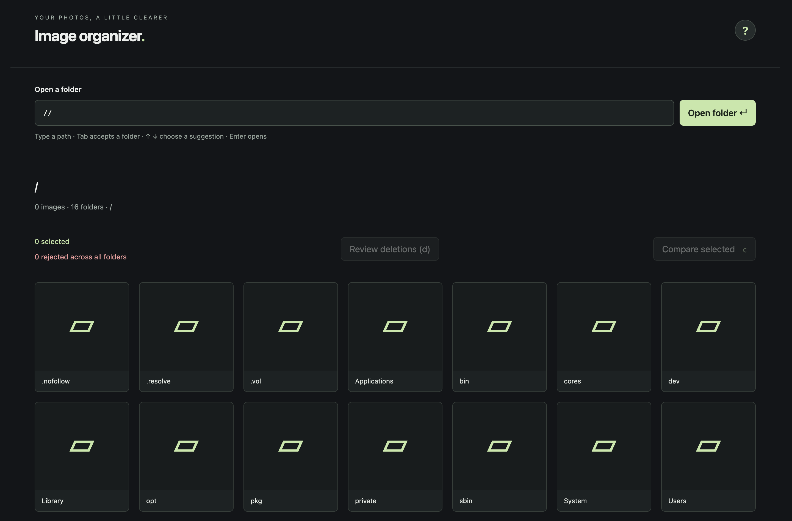

# Image organizer

A local, keyboard-driven image browser for macOS. Review photos, compare similar shots side by side, and move unwanted images to macOS Trash after checking a deletion preview.

Images stay on your computer. The app runs a Go server on `127.0.0.1:8080` and displays its interface in your browser; no cloud service or account is required.

## Requirements

- macOS with Xcode Command Line Tools (`xcode-select --install`). Native Trash handling uses Foundation through cgo.
- Go 1.27 or newer, with cgo enabled (the default for native builds).
- Make and Chrome.
- Node.js to run frontend tests.

## Get started

1. Clone this repository: `git clone https://github.com/AEkman/image-organizer.git`.
2. Enter the project: `cd image-organizer`.
3. Run `make run`.
4. Open [localhost:8080](http://localhost:8080) in Chrome.
5. Enter a folder path, such as `~/Pictures/`, and press Enter.

The first development run downloads the pinned Air tool and Go dependencies. Air rebuilds and restarts the server when source files change; refresh the browser manually. Press Control+C in the terminal to stop it.

To run without the development watcher, use `make build`, then `./bin/image-organizer`. The executable embeds the browser assets and uses the same local address.

## Browse and select

Folder suggestions appear as you type. Use Up/Down to choose a suggestion and Tab to accept it. Enter opens the typed folder. Images are sorted naturally by filename; child folders appear as separate tiles. Only the current folder's images are shown. Supported formats are JPEG, PNG, WebP and GIF; symlink entries are omitted.

Click an image or press Space to toggle its green selection. Selections can span multiple visited folders. Select at least two images and press `c` to compare them.

Press Shift to toggle the image under the pointer, or the focused image when none is hovered. Hold Shift and navigate, click, or move the pointer across folder-grid images to invert a range against its original selection. Selected images become unselected and unselected images become selected. Moving back shrinks the range and restores images outside it; releasing Shift commits it.

Selection and rejection are separate: green selection chooses images for comparison or batch actions; rejection marks an image as unwanted. Rejected images remain visible with a red border and dimming.

## Compare and review

In comparison, use `h`/`l` or Left/Right to move through the comparison group. Press `x` to toggle rejection on the current candidate. Sequential review stays on that image after toggling.

Press `s` for side-by-side comparison. The left image is pinned; navigation cycles unrejected candidates on the right. Press `p` to pin the current candidate. Rejecting a candidate advances to the next unrejected alternative. When no alternatives remain, the reference fills the view.

Press `a` for **All selected**, an overview of the original comparison group. Every opening starts with no active selection and focuses the first image. Rejection marks and the comparison group remain intact. Click or navigate to focus an image; use Space or Shift navigation to select images for batch actions.

In the folder grid and All selected overview:

- `x` toggles rejection for all selected images. If their states are mixed, it rejects all first; the next press restores all.
- With no selection, `x` toggles only the focused image.
- `u` restores selected images, or the focused image with no selection.
- `r` toggles rejection only on the focused image.

Close the overview with `a` or Escape to return to comparison. Press Enter in the overview, or Escape in comparison, to return to the folder grid and clear green selections while keeping rejection marks.

## Move rejected images to Trash

Rejection alone does not change files. Press `d` to review rejected images across all visited folders, with thumbnails, paths, a total count and individual Keep buttons.

1. Leave **Dry-run** enabled and run the preview to check what would move. No files change.
2. Review the list and unmark any files you want to keep.
3. Turn dry-run off (`t`) and activate **Move rejected files to Trash**.

Files move to macOS Trash rather than being permanently deleted. Successful moves disappear from the grid; failures remain rejected and show an error. A request supports up to 1,000 files. Opening the preview always enables dry-run again.

## Keyboard reference

Press `?` for the complete, context-specific shortcut help.

| Key                     | Action                                                   |
| ----------------------- | -------------------------------------------------------- |
| `h` / `j` / `k` / `l`    | Navigate thumbnails; `h` / `l` navigate comparison images  |
| Arrow keys              | Navigate images and folders                              |
| Space / click           | Toggle selection in the folder grid                      |
| Shift + navigation      | Invert a selection range                                 |
| `c`                     | Compare selected images                                  |
| `x`                     | Toggle rejection for the selection or current image      |
| `u`                     | Restore selection or focused image in grid / overview    |
| `r`                     | Toggle focused rejection in grid / overview              |
| `s` / `p`               | Toggle side-by-side / pin candidate                       |
| `a`                     | Open or close the comparison overview                    |
| `d` / `t`               | Open deletion preview / toggle dry-run in the preview     |
| `/`                     | Focus the folder path                                    |
| Tab / Shift+Tab         | Move between controls; Tab also accepts a path suggestion |
| Enter / Backspace       | Open a folder / open its parent in the folder grid        |
| Escape                  | Clear selection, return, or close the active dialog       |

## Development

- `make run`: start Air and the local app.
- `make test`: run Go backend tests and Node.js frontend interaction tests.
- `make build`: build `bin/image-organizer`.

The backend serves local files and handles native Trash operations. The frontend uses plain HTML, CSS and JavaScript, embedded in the executable. Air's proxy is disabled; the app binds only to the loopback address.

## Current limitations

- macOS and Chrome are the initial targets.
- Selection and rejection marks are kept only in browser memory and reset on reload or restart.
- Thumbnails use lazy-loaded original images; generated thumbnail caching and large-collection optimization are deferred.
- HEIC, zoom/pan and browser fullscreen are not implemented.

See [planned improvements](TODO.md), [requirements](docs/requirements.md) and the dated development notes in [docs](docs). This project began in an empty directory on 3 November 2026 for a SweClockers AI competition.

[AI usage](docs/ai-usage.md) records aggregate measured token usage and its limits. Detailed session evidence stays in the ignored local `spendage.md`; private session logs are not included in this repository.
